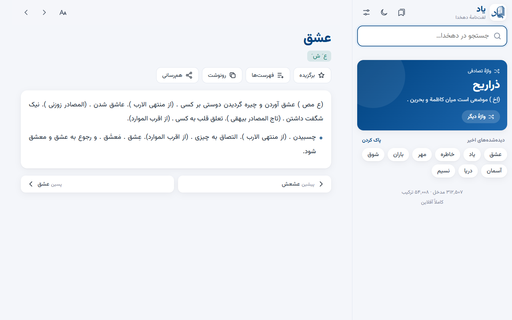
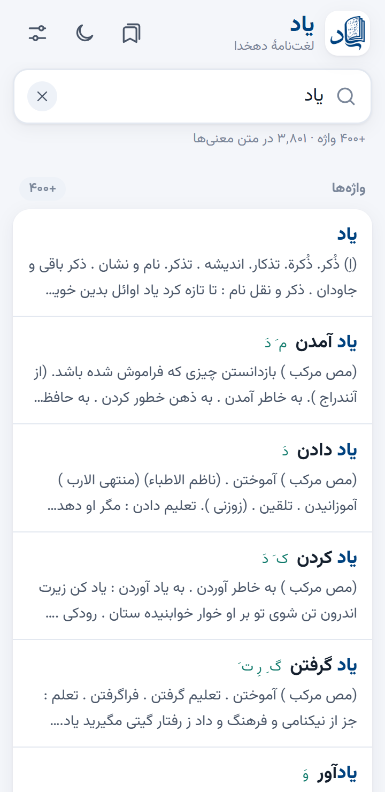
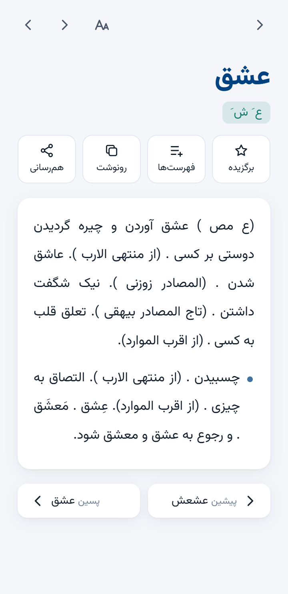
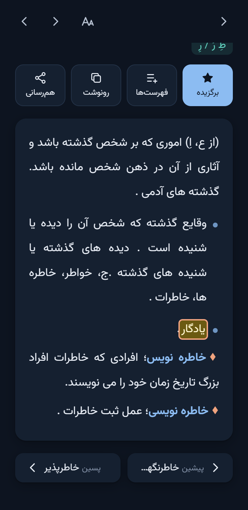

<div align="center">
  
  <h1>یاد · Yaad</h1>
  <p><b>لغت‌نامهٔ دهخدا، سریع، سبک و کاملاً آفلاین</b><br/>
  The Dehkhoda Persian dictionary: fast, lightweight and fully offline.</p>

  <p>
  <a href="https://github.com/shahind/Yaad/releases/latest"></a>
  <a href="https://github.com/shahind/Yaad/releases/latest"></a>
  <a href="https://github.com/shahind/Yaad/releases/latest"></a>
  <a href="https://github.com/shahind/Yaad/releases/latest"></a>
  <a href="https://cafebazaar.ir/app/com.shahinsoft.yaad"></a>
  </p>
  <p><a href="https://shahind.github.io/Yaad/"><b>▶ Open the web version</b></a></p>

  
  <br/><br/>
  &nbsp;
  &nbsp;
  
</div>

## Download

| Platform | |
|---|---|
| Web | [shahind.github.io/Yaad](https://shahind.github.io/Yaad/), installable, works offline |
| Android | [Cafe Bazaar](https://cafebazaar.ir/app/com.shahinsoft.yaad) or the `.apk` from [Releases](https://github.com/shahind/Yaad/releases/latest) |
| iOS | unsigned `.ipa` from [Releases](https://github.com/shahind/Yaad/releases/latest) (install with AltStore or Sideloadly) |
| Windows | installer or portable `.exe` from [Releases](https://github.com/shahind/Yaad/releases/latest) |
| Linux | `.AppImage` or `.deb` from [Releases](https://github.com/shahind/Yaad/releases/latest) |

## Features

- All **312,507 entries** of Dehkhoda, plus 54,008 phrases found inside other entries.
- **Instant search** as you type. Spaces, half-spaces, diacritics and Arabic letter forms don't matter.
- **Search inside meanings**: «یاد» also finds «خاطره».
- **Favorites and your own lists**, recent words, a random word.
- **Copy and share** meanings.
- Light and dark themes, adjustable text size.
- **No internet needed**, no ads, no data collected.

---

## For developers

### Why it is fast and light

- The 255 MB source dictionary is packed into **56 MB** of compressed data.
- Meanings are stored in small blocks and loaded only when shown. Persian text is re-encoded to one byte per letter before compression.
- Headwords stay in memory as one normalized string, so a word search takes **2–20 ms**.
- Meanings are searched through a prefix-sharded index; a query loads only the parts it needs.
- Search runs in a Web Worker, so typing never blocks the screen. The app starts in about 250 ms.

### Technology

Plain **JavaScript, HTML and CSS**, with no framework and no bundler. **Capacitor** wraps it for Android and iOS, and **Electron** for Windows and Linux. The data is built with **Node.js** scripts in `tools/`.

### Run, test, build

Needs Node.js 20+.

```bash
npm install
npm run build:data   # build the dictionary data into www/data
npm test             # search tests
npm run serve        # open http://localhost:5173
```

| Target | Command |
|---|---|
| Desktop app | `npm run electron` |
| Windows build | `npm run dist:win` |
| Linux build | `npm run dist:linux` |
| Android | `npm run android` (opens Android Studio) |
| iOS | `npm run ios` (opens Xcode, macOS only) |

## Credits

- Content: *Loghatnameh-ye Dehkhoda* (لغت‌نامهٔ دهخدا), SQL format by [Nimah79](https://github.com/nimah79/Dehkhoda-SQL).
- Font: [Vazirmatn](https://github.com/rastikerdar/vazirmatn) (SIL Open Font License).
- Code: [GNU GPL v3](LICENSE).
